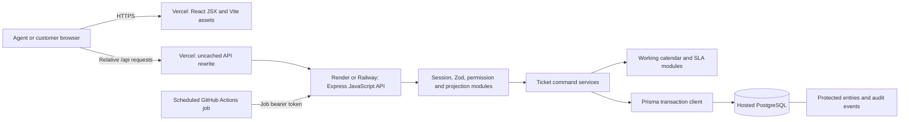

# 05 — Architecture

Status: approved design baseline; Phase 2 explicitly authorized on 2026-11-21. Execution evidence is recorded in [16 — Implementation log](16-IMPLEMENTATION_LOG.md).

## Components and trust boundaries

There are separate frontend and backend deployments. Vercel's external rewrite keeps browser requests on the frontend origin; it is not a backend application hosted on Vercel. `/api/*` forwards to backend `/api/*` before any frontend route fallback. Render/Railway exposes the Node API, health, and maintenance endpoints; PostgreSQL is the durable authority. An API/auth response must never enter the CDN cache. [Vercel rewrites](https://vercel.com/docs/rewrites).

Use express-session with a PostgreSQL store, Argon2id password verification, session-bound CSRF tokens, and an exact trusted frontend-origin list. The browser never chooses an actor, deadline, role, or note visibility. Job bearer authentication authorizes only maintenance. The session store uses its package-compatible table; it is separate from ticket transactions.

Customer and agent routes use distinct Prisma filters and response builders. Customer entries are filtered to PUBLIC_REPLY before pagination, then projected through a strict public Zod DTO. Do not send full database records or filter private information only in JSX.

## Implemented Phase 2 source organization

| Area | Responsibility |
| --- | --- |
| `frontend/src/main.jsx` | React mount, Router/Query providers, named screen and shared UI components |
| `frontend/src/styles.css` | Tailwind integration and responsive workspace styling |
| `frontend/src/api.js` | Fetch wrapper, audience-scoped query keys and session-expiry notification |
| `backend/src/app.js`, `backend/src/server.js` | Export Express app for Supertest; separate network listener |
| `backend/src/config.js`, `auth.js`, `errors.js` | Zod environment parsing, sessions, CSRF, authorization and errors |
| `backend/src/routes.js`, `contracts.js`, `events.js` | Route adapters and strict input/event schemas |
| `backend/src/tickets.js` | Locked commands, transactional audit and maintenance |
| `backend/src/calendar.js` | Pure calendar/target functions with explicit clock input |
| `backend/src/db.js`, `reads.js`, `projections.js` | Prisma connection, bounded queries and validated audience DTOs |
| `backend/prisma/schema.prisma`, `backend/prisma/migrations/` | Data model and SQL migrations including checks, grants and triggers |
| `backend/prisma.config.js`, `backend/scripts/` | JavaScript Prisma configuration, seed and maintenance entry points |
| `backend/tests/`, `frontend/src/*.test.js`, `frontend/scripts/browser-smoke.js` | Vitest, Supertest/PostgreSQL and real Edge browser verification |
| `docs/` | Policy, runtime contracts, verification and deployment instructions |

Use separate frontend/backend npm packages and lockfiles, keeping host build roots simple. Do not create empty scaffolding in Phase 1. Shared code must have a clear purpose; do not add a service or repository abstraction merely to wrap Prisma. Server secrets/database clients never enter frontend imports.

## Request and mutation protocol

Express middleware validates content type/body size, loads the session, and applies route-specific Zod schemas and role/CSRF/origin guards. A route calls one command service and maps its returned domain result to the documented JSON response.

For an existing ticket command:

1. Scope customer lookup to their identity and establish route access. Never query staff data for a customer.
2. Start a Prisma interactive `$transaction` at PostgreSQL READ COMMITTED isolation. On that transaction client, issue parameterized `SELECT ... FOR UPDATE` for the ticket. Every subsequent read, write, and audit insert uses that same client; no root Prisma call inside the callback.
3. Recheck command-specific ownership/state. Claim is exempt from the owner-only write guard so another claimant can receive ALREADY_CLAIMED. Read database clock time after acquiring the lock, truncated to milliseconds, and use it throughout the command.
4. If a customer wait has expired, commit the independent closure and return a domain conflict result from the callback. Map it to HTTP 409 after `$transaction` resolves; throwing inside the callback would wrongly roll back closure.
5. Apply the claim retry exception, staff expected_version, and state rules. Evaluate old SLA breaches before changing clocks. A routine rejected command has no requested side effect.
6. Perform the requested state change, immutable entry insertion, clock checkpoint, version increment, and audit append atomically. A normal accepted command increments version once, even if it creates several events.
7. Await commit, project the audience DTO, validate it with Zod, then send the HTTP result. An audit/entry failure rejects the transaction and no successful mutation is reported.

Set explicit short transaction/lock timeouts (5 seconds waiting and 10 seconds transaction budget). Do no password hashing, HTTP calls, or other external I/O while holding a ticket lock. Map exhausted lock/transaction timeouts to 503; do not automatically retry a possibly committed message. READ COMMITTED plus the row lock is sufficient for these one-ticket operations; unique constraints protect additional invariants. [Prisma transactions](https://www.prisma.io/docs/orm/v7/prisma-client/queries/transactions), [parameterized raw queries](https://www.prisma.io/docs/orm/v7/prisma-client/using-raw-sql/raw-queries), [PostgreSQL locking](https://www.postgresql.org/docs/17/explicit-locking.html).

No read-then-update claim outside a transaction, process-local mutex, or frontend optimistic assignment can replace the lock. Tests use separate database connections. Error logs may record safe rejection metadata but never invent successful business events.

## JavaScript data and SLA boundaries

All project source is JavaScript/JSX with ES modules. Strict Zod schemas validate inputs and configuration; explicit DTO builders and response schemas guard outputs. JavaScript lint and contract tests are required; no static type compiler is involved.

Use UTC Date instants at millisecond precision and Luxon for business-zone calendar boundaries. Persist `timestamptz(3)` and exact integer millisecond durations. Prisma BigInt values must not reach JSON directly: audit IDs become decimal strings, and duration conversion to Number requires a safe-integer check. Store versions as bounded positive PostgreSQL integers. See schema/API documents for the full mapping.

The ticket keeps the original calendar snapshot, response evidence, resolution budget/consumption/running segment, current deadlines and terminal/waiting cutoffs. Audit events preserve each checkpoint. GETs derive SLA flags with one database `as_of` time, without writing or accruing stored counters. Filter/sort in PostgreSQL before pagination; do not load every ticket into React or perform SLA arithmetic in a browser.

## Maintenance execution

The scheduler calls backend `POST /api/internal/maintenance` every five minutes. A `.js` operator script invokes the same service. Select due waits and newly overdue metrics, process at most 100 candidates per call, and return counts plus has_more. The runner follows has_more for at most ten calls per run.

Each candidate uses its own Prisma transaction and parameterized `FOR UPDATE SKIP LOCKED`, then current-state validation. Repeated/overlapping runs create no duplicate closure or first-breach events. Successful tickets remain committed if another candidate fails. Errors are counted and cause the runner to report failure without leaking ticket content.

No Node in-memory timer is authoritative for a business deadline. Restart/sleep loses no due state. Mutations enforce cutoffs even after a missed job; GET can temporarily show closure pending. Preserve distinct effective and recorded times for delayed automatic processing.

## React routing and data flow

Use React Router declarative routes from document 07. Fetch the session before mounting an audience's protected views; route guards are convenience, with authorization still on Express. TanStack Query keys begin with audience and authenticated user ID, followed by resource, ticket ID and filters/cursor as appropriate. Staff and public entries must never share a cache key.

On successful mutation, set/invalidate the appropriate detail, entries, queue, and staff audit queries. On 409, retain the draft and invalidate/refetch state. Disable automatic mutation retries and optimistic claim/message success. Query retries are limited to safe GET transport errors, never 401/403/404. Manual refresh is required; optional visible-tab polling is 30 seconds. Stop/background-disable polling when hidden.

On logout, expired session or identity change, cancel in-flight queries, unmount protected views, clear the QueryClient, and clear private drafts before rendering another user. Do not persist query data or drafts in localStorage. Tailwind supplies readable layouts and separate public/private composer styles.

## Deployment and operational boundaries

Vercel builds `frontend/dist`; Render/Railway installs backend packages, generates the JavaScript Prisma client, and runs `node src/server.js`. No server compilation, static frontend collection into the backend, or Vercel database client is required. One Node process and bounded connection pools are sufficient; PostgreSQL locks remain essential despite JavaScript's event loop.

Migrations/custom SQL run with an operator-only owner credential; the live backend and session store share restricted runtime access with separate bounded pools. No automatic migrate/reset/seed on startup. Configure the frontend rewrite target explicitly, verify Set-Cookie forwarding and CSRF origin handling, and test that unknown API paths remain JSON 404 rather than SPA HTML. See [09 — Security](09-SECURITY.md) and [13 — Deployment](13-DEPLOYMENT.md).
