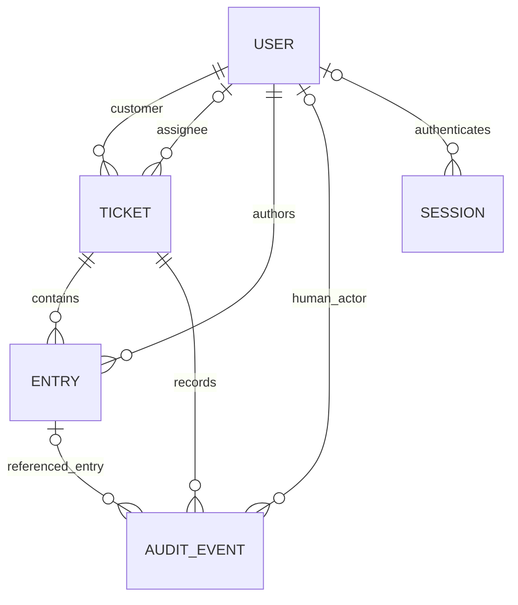

# 06 — Database schema

Status: approved design baseline; Phase 2 explicitly authorized on 2026-11-21. Execution evidence is recorded in [16 — Implementation log](16-IMPLEMENTATION_LOG.md).

## Relationships

The session relationship is logical: express-session stores an optional user ID in its JSON payload, so the anonymous CSRF-bootstrap session has no user yet. Four business entities plus one session table are sufficient. Prisma models and SQL migrations own the database schema; connect-pg-simple accesses its compatible session table directly as infrastructure, using the same restricted runtime credentials. Calendar configuration is deployment data copied into each ticket, not an administration subsystem.

## User

Use a Prisma User model and an established Argon2id password library. Authentication/session middleware is JavaScript; there is no built-in framework user model to assume.

| Field | Type / constraint | Meaning |
| --- | --- | --- |
| `id` | UUID primary key | Internal identity; Prisma String with native UUID, JSON string |
| `username` | varchar(150), unique, lowercase | Seeded login; trim/lowercase before lookup; no registration endpoint |
| `password_hash` | text, required | Argon2id encoded hash; never API-visible |
| `is_active` | boolean, default true | Checked when authenticating and on protected requests |
| `last_login_at` | timestamptz(3), nullable | Set by server after successful authentication |
| `display_name` | varchar(120), required | Immutable demo display identity; no user administration API |
| `role` | text check: AGENT or CUSTOMER, not null | Application role; no client-controlled role changes |

Service validation requires the ticket customer to be CUSTOMER and assignee to be AGENT. Foreign keys alone cannot enforce cross-table role values. No user deletion, role editing, or admin route is exposed. Session data stores the user ID and CSRF secret; role and active status are read from User, not accepted from the browser or trusted as a stale session snapshot. Deactivate instead of removing any referenced identity.

## Ticket

| Field | Type / nullability | Invariant / use |
| --- | --- | --- |
| `id` | UUID primary key | Random identifier; still require authorization |
| `customer_id` | User FK, required, restrict deletion | Owning customer, immutable |
| `assignee_id` | User FK, nullable, restrict deletion | Null only while OPEN; assigned once |
| `subject` | varchar(160), required | Trimmed, nonempty, immutable after creation |
| `description` | text, required, max 10,000 characters via validation | Original public problem, immutable |
| `priority` | text: HIGH, MEDIUM, LOW | Default MEDIUM; owner may change in eligible state |
| `status` | text: OPEN, IN_PROGRESS, WAITING_CUSTOMER, RESOLVED, CLOSED | Only domain services change it |
| `version` | positive integer, initial 1 | Prisma Int / JSON safe integer; increments on successful mutation or maintenance update |
| `created_at` | timestamptz(3), required | Immutable authoritative creation instant |
| `updated_at` | timestamptz(3), required | Last committed projection mutation; staff-only metadata |
| `calendar_snapshot` | jsonb, required | Frozen policy version, timezone, weekdays, local opening/closing, sorted holidays |
| `first_response_due_at` | timestamptz(3), required | Recomputed on priority change only while unanswered; frozen after response |
| `first_response_at` | timestamptz(3), nullable | First accepted owner public reply; write-once |
| `first_response_entry_id` | Entry FK, nullable, restrict deletion | Set with first response; points to public agent entry on this ticket |
| `first_response_breached_at` | timestamptz(3), nullable | First observation of a breach, never cleared; event retains deadline |
| `resolution_budget_ms` | bigint, required, positive | Exact integer millisecond allowance under current priority and original effective start |
| `resolution_consumed_ms` | bigint, required, nonnegative | Exact integer milliseconds in completed running segments, initially zero |
| `resolution_running_since` | timestamptz(3), nullable | Present in OPEN/IN_PROGRESS; null in paused/terminal states |
| `resolution_due_at` | timestamptz(3), nullable | Running deadline; null while waiting/closed; frozen final target when resolved from running |
| `resolution_breached_at` | timestamptz(3), nullable | First breach observation, never cleared |
| `wait_started_at` | timestamptz(3), nullable | Current waiting episode only |
| `auto_close_due_at` | timestamptz(3), nullable | Current wait start plus 45 working hours |
| `resolved_at` | timestamptz(3), nullable | Current resolved episode; cleared on reopen, retained in audit |
| `reopen_until` | timestamptz(3), nullable | Current resolved time plus 168 elapsed hours |
| `closed_at` | timestamptz(3), nullable | Effective inactivity cutoff for CLOSED |
| `close_reason` | text, nullable; only CUSTOMER_TIMEOUT | Distinguishes timeout from successful resolution |

`resolution_budget_ms` and `resolution_consumed_ms` use Prisma BigInt / PostgreSQL bigint, with checks limiting each to JavaScript's safe integer range (0 to 9,007,199,254,740,991; budget must be positive). Convert to domain Number milliseconds only after checking the range, and convert back explicitly on persistence. Derived remaining time may be negative. There are no database interval columns, floating-point accumulated durations, or implicit BigInt-to-JSON conversions.

Calendar JSON has exactly these keys: `policy_version` (`v1`), `timezone` (`Asia/Kolkata`), `working_weekdays` (ISO 1–5), `opens_at` (`09:30:00`), `closes_at` (`18:30:00`), and `holidays` (unique ISO local date strings). Deduplicate and sort valid holiday input; reject malformed dates. Validate at configuration load and ticket creation. Never accept this object from a customer. A malformed calendar prevents creation rather than silently skipping holidays.

### Ticket constraints

- OPEN requires null assignee; all other states require an assignee. Assignment cannot be cleared or transferred through the service.
- `resolution_running_since` and a nonnull deadline are required in OPEN/IN_PROGRESS; running-since is null in WAITING_CUSTOMER/RESOLVED/CLOSED. Resolution deadline is null in WAITING_CUSTOMER/CLOSED and may be null in RESOLVED when resolved from waiting.
- Both waiting timestamps are present exactly in WAITING_CUSTOMER. They are cleared on resume, resolve, or close; their prior values are retained in audit.
- RESOLVED alone has `resolved_at` and `reopen_until`; `reopen_until` must be later. CLOSED alone has `closed_at` and CUSTOMER_TIMEOUT. Resolution from waiting may legitimately have null final deadline.
- First-response timestamp and entry reference are either both null or both present. WAITING_CUSTOMER/RESOLVED/CLOSED must have a first response, since a public question/resolution was required.
- Nonnegative consumed duration, positive budget/version, allowed enums, required text, and FK integrity receive database checks. Entry author/role/ticket consistency, exact calendar arithmetic, one-way ownership, and immutable ticket fields are enforced in the locked domain service and covered by tests.
- No cascade deletion of tickets, entries, or events. Runtime role has no ticket DELETE/TRUNCATE; original identity, description, and calendar are never editable through the application. The trusted database owner remains outside this boundary.

The circular first-response entry FK is initially null: insert ticket, later insert public entry, then set the ticket's first-response reference in one transaction. A creation description is stored on the ticket, not duplicated as an entry.

## Entry

| Field | Type / constraint | Meaning |
| --- | --- | --- |
| `id` | UUID primary key | No sequential count reveals private-note gaps |
| `ticket_id` | Ticket FK required, restrict deletion | Parent ticket |
| `author_id` | User FK required, restrict deletion | Actor taken from session |
| `author_role`, `author_label` | Immutable text snapshot | Role and display name at creation |
| `kind` | PUBLIC_REPLY or INTERNAL_NOTE | Chosen by route, not a generic visibility toggle |
| `body` | text, trimmed nonempty, 1–10,000 characters | Plain text; public or private according to immutable kind |
| `created_at` | timestamptz(3) required | Same command time as associated business action |

Only agents can author INTERNAL_NOTE; public entries can be agent replies or customer replies/reopen explanations. Entry body, kind, author, and timestamps are append-only. There are no edit, delete, or “make public” operations. Immutable messages preserve the exact text referenced by audit evidence.

## AuditEvent

| Field | Type / constraint | Meaning |
| --- | --- | --- |
| `id` | bigint generated primary key | Prisma BigInt; serialize as decimal string in JSON/cursors; gaps are harmless |
| `ticket_id` | Ticket FK required, restrict deletion | Audit stream owner |
| `actor_id` | User FK nullable, restrict deletion | Required for human action, null for SYSTEM |
| `actor_type` | AGENT, CUSTOMER, SYSTEM | Check null actor iff SYSTEM |
| `actor_label` | text required | Immutable name snapshot or `SYSTEM` |
| `event_type` | constrained text enum | One of the events listed below |
| `entry_id` | Entry FK nullable, restrict deletion | Immutable message being referenced, when applicable |
| `occurred_at` | timestamptz(3) required | Authoritative command/observation time after lock |
| `effective_at` | timestamptz(3) required | Normally occurred_at; deadline cutoff for a delayed automatic action |
| `recorded_at` | timestamptz(3), DB-generated clock timestamp | Actual insertion time; a BEFORE INSERT trigger sets database clock time unconditionally |
| `ticket_version` | positive integer | Projection version produced by this command |
| `data` | jsonb, required | Event-specific Zod-validated old/new fields; no passwords, tokens, or duplicated message bodies |

Event types: `TICKET_CREATED`, `TICKET_CLAIMED`, `PUBLIC_REPLY_ADDED`, `INTERNAL_NOTE_ADDED`, `WAIT_STARTED`, `WAIT_ENDED`, `PRIORITY_CHANGED`, `TICKET_RESOLVED`, `TICKET_REOPENED`, `TICKET_AUTO_CLOSED`, `FIRST_RESPONSE_BREACHED`, `RESOLUTION_BREACHED`.

Creation captures initial state, budgets, deadlines, and calendar snapshot. State changes capture before/after state and clock fields. Priority changes add required reason and old/new priority. Message actions reference the entry, and their event data captures a first-response change when applicable. Breach events include target deadline, policy/priority, observed state, and remaining duration. Reopen/resolve events retain prior terminal timestamps and clock checkpoint. Auto-close includes wait start, due cutoff, effective closure, and processing time. Multiple events can share a command time/version; order by audit ID for a stable display.

One partial unique constraint per ticket/metric breach event type prevents duplicate first-breach events. Do not use arbitrary user-supplied JSON. Event metadata is staff-only even when it describes a public reply.

## Session and Prisma representation

The session table is managed by a migration compatible with the pinned connect-pg-simple package: `sid` varchar primary key, `sess` JSON, and `expire` timestamp with an index. It contains cookie metadata, optional user ID, session-bound CSRF state, and an absolute eight-hour expiry after login. Bootstrap may create an anonymous session. It is mutable operational data and is not subject to append-only evidence triggers. Disable the session store's create-table-on-start option.

Use the store's documented timestamp representation for `expire`, with Node and database connections configured to UTC; ticket/SLA/audit timestamps separately use timestamptz(3). Prisma may map this table for migration tracking, but its contents remain owned by the session middleware. Sessions are not included in ticket command transactions or customer API projections. [Session store schema](https://github.com/voxpelli/node-connect-pg-simple/blob/main/table.sql).

| Stored concept | Prisma / JavaScript / wire mapping |
| --- | --- |
| User, ticket, entry UUID | Prisma String with native UUID; JavaScript string; JSON string |
| Business/audit timestamp | Prisma DateTime with native Timestamptz(3); JS Date; UTC ISO string with exactly three fractional digits |
| Duration counter | Prisma BigInt; checked safe integer milliseconds in SLA module; numeric seconds with at most three decimals in SLA DTO |
| Audit ID | Prisma BigInt; keep exact; JSON decimal string, including after_id/next_after_id cursors |
| Version | Prisma Int; Zod positive integer capped at 2,147,483,647; JSON number |
| Calendar / event data | Prisma Json; strict Zod schema before use; contains only JSON-compatible values |
| Enumerations | Prisma enum or checked text, aligned with shared documented values; Zod enum at input/output boundary |

Use explicit model/table and field mappings so readable Prisma camelCase names map to the snake_case columns documented here and the unchanged snake_case API fields. Prisma relation objects are not response DTOs. Use relationMode=foreignKeys; do not emulate referential integrity only in application code. Password/session values never leave backend modules.

Parameterize lock SQL through the transaction client's `$queryRaw`. Use Prisma interactive transactions; pass the transaction client to every helper. Migrations include custom SQL for CHECK constraints, partial indexes, role grants, and immutable triggers because not every PostgreSQL feature is represented by Prisma schema syntax. Create/review migrations in development, apply them with Prisma Migrate in release, and never replace them with `db push` in hosting. [Prisma database features](https://www.prisma.io/docs/orm/v7/reference/database-features), [raw queries](https://www.prisma.io/docs/orm/v7/prisma-client/using-raw-sql/raw-queries).

## Indexes and database access

| Index | Purpose |
| --- | --- |
| Ticket `(assignee_id, status, created_at, id)` | Mine/assigned queue |
| Ticket `(customer_id, created_at, id)` | Customer-scoped list |
| Ticket `(status, created_at, id)` | Unassigned and active queue |
| Ticket partial `(auto_close_due_at, id)` where WAITING_CUSTOMER | Timeout sweep |
| Ticket partial due indexes for unanswered first response and running resolution | Overdue selection without scanning terminal history |
| Entry `(ticket_id, created_at, id)` and `(ticket_id, kind, created_at, id)` | Staff conversation and public-only conversation |
| AuditEvent `(ticket_id, id)` | Paginated ordered history |

Use ordinary SQL filters, stable ordering, and bounded pagination. At this scale additional search indexes and summary tables are unnecessary.

## Immutability and migration roles

Implementation detail: migrations install constraints, indexes, evidence/timestamp triggers and default-deny PUBLIC revocations. The version-controlled `backend/scripts/grant-runtime.js` performs the exact narrow grant table below as an explicit owner-run post-migration step, since development, test and hosted role names differ. This is not runtime startup code; omitting it leaves runtime access denied. Both development and test grants have been verified against actual restricted connections.

Local provisioning uses the official Docker PostgreSQL 17 service. Its initial `frontdesk` administrator is only used by operator provisioning. `frontdesk_owner` owns development objects and `frontdesk_runtime` serves the app; `frontdesk_test_owner` and `frontdesk_test_runtime` access the separate `frontdesk_test` database. Do not put administrator or owner URLs in backend runtime configuration. Never delete a Docker volume or reset existing data as a migration shortcut.

An operator/migration role owns objects and installs protections. A separate runtime role may select/insert audit and entry rows but has no update/delete/truncate privileges on them, no schema CREATE, no trigger-management privileges, and no ability to assume the owner role. Triggers reject UPDATE/DELETE and statement-level TRUNCATE on those tables as defense in depth. Grant only required privileges on tickets, users, sessions, and sequences; revoke inherited/PUBLIC privileges that would bypass restrictions. PostgreSQL privileges distinguish these operations and object ownership remains privileged. [PostgreSQL privileges](https://www.postgresql.org/docs/17/ddl-priv.html), [trigger operations](https://www.postgresql.org/docs/17/sql-createtrigger.html).

The runtime grant set is intentionally narrow:

| Object | Runtime operations |
| --- | --- |
| Ticket | SELECT, INSERT, UPDATE; no DELETE/TRUNCATE |
| Entry and AuditEvent | SELECT, INSERT; no UPDATE/DELETE/TRUNCATE; audit recorded_at enforced by DB insert trigger |
| User | SELECT and column UPDATE on password_hash/last_login_at for authentication; no role change, creation, or deletion |
| Session table | SELECT, INSERT, UPDATE, DELETE for session lifecycle |
| Required generated-ID sequences | USAGE only; no sequence reset privilege |
| Schema, triggers, owner role | No CREATE, guard alteration, or owner membership/assumption |

An AuditEvent BEFORE INSERT trigger unconditionally assigns recorded_at from the database clock truncated to milliseconds, even if a Prisma INSERT supplies a value. This avoids relying on ORM field omission or a caller-overridable default. Read that generated value back before returning staff history. Migrations and initial demo seeding run separately with owner access; runtime never receives its credential. Tests explicitly connect as the runtime role for immutability checks. Test-database cleanup may use an isolated test owner; it must not weaken production migrations to accommodate test cleanup.

## Seed and retention

Seed at least two agents and two unrelated customers to demonstrate races and cross-customer isolation; nine agents may be included without adding features. Demo accounts have only AGENT or CUSTOMER roles. Use synthetic tickets that show an unassigned item, active work, waiting, resolved, and breach history, through the domain service with an explicit fixture clock in test/seed tooling only. Mark those subjects `[DEMO]` and audit data `fixture=true`; this is synthetic evidence, not purported real activity. There is no production API for setting time.

Retain all demo ticket entries and audit through the review week. Never run a destructive reseed on deploy/restart. No retention/deletion job is part of the assignment. [13 — Deployment](13-DEPLOYMENT.md) defines migration, credential, and persistence checks.
